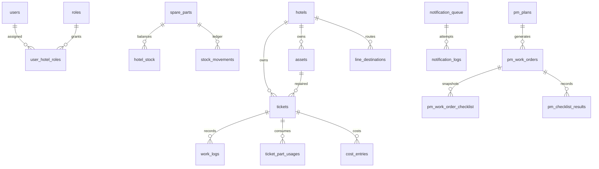

# Database

ใช้ InnoDB/utf8mb4, native prepared statements, UTC DATETIME และ DECIMAL ค่าเงิน ความสัมพันธ์สำคัญบังคับ `(id, hotel_id)` เพื่อไม่ให้อุปกรณ์/ใบงาน/ต้นทุนข้ามโรงแรม

## Table groups

| กลุ่ม | ตาราง |
|---|---|
| องค์กร | hotels, departments, buildings, floors, locations |
| บัญชี/สิทธิ์ | users, roles, permissions, role_permissions, user_hotel_roles, technician_rates |
| Authentication | login_attempts, password_reset_tokens (ยังไม่มี email reset UI) |
| อ้างอิง | maintenance_categories, priorities, sla_rules, asset_categories, part_categories, suppliers |
| อุปกรณ์ | assets, asset_attachments, asset_history |
| ใบงาน | tickets, ticket_assignments, ticket_status_logs, ticket_comments, ticket_attachments, work_logs, ticket_approvals |
| คลัง | spare_parts, hotel_stock, stock_movements, stock_transfers, stock_transfer_items, ticket_part_usages |
| ซื้อ | purchase_requests, purchase_request_items |
| แจ้งซ่อมสาธารณะ | public_repair_submissions (ช่องทางติดต่อผู้แจ้ง, hash ป้องกันการส่งซ้ำและจำกัดจำนวน) |
| PM | pm_plans, pm_checklist_items, pm_work_orders, pm_work_order_checklist, pm_checklist_results |
| การเงิน | cost_categories, cost_entries, budgets |
| แจ้งเตือน | user_notifications, line_destinations, notification_rules, notification_queue, notification_logs, line_webhook_events |
| ระบบ | settings, audit_logs, number_sequences, migrations |



## Migrations

001: core/RBAC; 002: maintenance/assets; 003: inventory/purchase; 004: PM; 005: finance; 006: notifications; 007: PM checklist snapshots

```sh
php scripts/migrate.php
php scripts/migrate.php --test
```

Migrator บันทึกชื่อไฟล์ใน migrations ไม่รันไฟล์ที่สำเร็จแล้วซ้ำ `seed.sql` ใส่ reference data แบบ idempotent ไม่ล้างฐาน ไม่มี auto rollback สำหรับ DDL เพราะ MySQL ทำ implicit commit ให้ backup ก่อน migration และรันเพียง process เดียว หาก migration ขาดกลางทาง ให้ตรวจตารางที่สร้างแล้วและ restore backup หรือแก้ forward migration หลังตรวจสอบ ห้าม drop ตารางเดิมแบบเดาสุ่ม

`database/schema.sql` เป็น schema รวมสำหรับตรวจทาน/สร้างฐานใหม่เท่านั้น แนะนำใช้ Migrator เพื่อมี migration tracking ห้าม import schema รวมทับฐานที่มีข้อมูล

## Integrity and history

- UNIQUE: users.email, ticket_no, asset_code, qr_token, hotel_stock(hotel,part), PM(plan,due), queue.dedupe_key, webhook_event_id
- CHECK: stock >= 0, quantity > 0, transfer source != target, valid statuses/frequencies, nonnegative approved values
- Generated nullable-key columns ทำให้ global role/notification/budget uniqueness enforce ได้
- ค่าแรง snapshot ตอนบันทึกเวลา ต้นทุนอะไหล่ snapshot ตอนเบิก และ PM checklist snapshot ตอนสร้าง work order
- ไม่ลบประวัติ operational ด้วย UI ยกเลิกงาน ใช้ reversal หรือ inactive แทน
- migration 007 ย้อนสร้าง checklist snapshot ของใบงานเก่าจาก definition ปัจจุบัน ไม่สามารถกู้ชื่อ checklist ก่อน migration ที่เคยถูกแก้ไปแล้ว

ทดสอบ migration ทั้ง 7 ชุดบน MariaDB 10.4.32 แล้ว; MySQL 8 ต้องยืนยันใน staging ตามเป้าหมาย deployment
